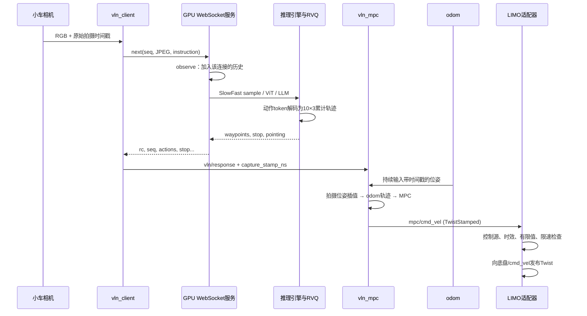

# LightNav-0 文件结构、运行原理与 LIMO Pro 复现分析

分析日期：2026-09-24。依据本机 `/home/xrq/projects/LightNav-0` 和 `/home/xrq/projects/OmniVLA` 的实际源码、配置与部署记录。

本文只做代码分析和实施清单，不修改运行代码，不启动 GPU 服务或实车节点。文中“已有”指代码已实现，不代表本次已在你的车上验证；“建议新增”均尚未实现。OmniVLA 的雷达检测、语义拓扑、回溯巡检、YOLO 和深度到达检测不纳入迁移范围。

## 1. 先理解项目要做什么

LightNav 将**语言指令 + 当前及历史 RGB 图像**转换为**未来一段机器人局部轨迹**。小车上的控制器再把轨迹变为底盘速度。因此它不是直接把一句话转成 `/cmd_vel`，也不要求先建立语义拓扑图。

本仓库主要提供推理、服务、仿真评测和实车部署；没有完整的数据采集、训练优化器与训练主循环。虽然预处理保留了训练时的标签和模板规则，不能据此认为这个仓库可以直接完成重新训练。

针对你的 LIMO Pro，最合适的复现路线是：

```text
小车既有 LIMO 驱动                      GPU 主机
  ├─ /odom                               lightnav-serve --task vln
  └─ 接收 /cmd_vel                              ↑↓ WebSocket
大白/Orbbec 彩色相机 → vln_client ────────────────┘
                          ↓ vln/response：轨迹 + 拍摄时间戳
/odom 或 /odometry/filtered → vln_mpc
                          ↓ mpc/cmd_vel：TwistStamped
                     新增 limo_adapter
                          ↓ /cmd_vel：Twist
                      LIMO 底盘驱动 → 车轮
```

可直接沿用 LightNav 的模型、RVQ 解码、WebSocket、轨迹跟踪主体。OmniVLA 可以提供你这辆车的驱动启动方式，以及图像与速度接口的实现参考；无需迁移整个 OmniVLA 客户端。

## 2. 顶层结构：哪些属于运行链路

以下路径默认相对于 LightNav-0 根目录；同类资源文件合并说明，核心源文件逐项列出。

```text
LightNav-0/
├── src/lightnav/          模型推理库、服务端、离线工具和评测客户端
├── checkpoints/LightNav-0/ 本地模型、tokenizer、预处理配置和 RVQ 码本
├── robot_deploy/          实车 ROS 2 工作区：视觉客户端、MPC、网页、底盘适配
├── mujoco_demo/           独立 MuJoCo 仿真项目，无需 ROS
├── habitat_server/       独立 Habitat 环境服务，和模型环境分开安装
├── evt_bench/            对接外部 EVT-Bench 的客户端与补丁
├── scripts/              启动服务、评测、GPU 冒烟验证脚本
├── tests/                推理与协议等测试，不是机器人运行入口
├── docs/                 使用文档和展示图片
├── docker/               容器入口
├── pyproject.toml        Python 依赖、打包与命令注册
├── Dockerfile            推理容器构建
├── Makefile              检查和测试快捷入口
├── README.md             项目总览、安装和示例
├── AGENTS.md             本仓库自动化协作约定
├── LICENSE               本项目许可证
├── THIRD_PARTY_NOTICES.md 第三方代码和资源许可说明
└── richie.md              本机已有服务/MuJoCo 启动笔记
```

- `.gitignore`、`.dockerignore`：分别控制版本管理与容器构建时忽略哪些文件。
- `.git/`：版本数据库；`.venv/`：本地依赖环境；`*.egg-info/`：安装生成的元数据；`__pycache__/`：Python 缓存。它们不是导航算法模块。
- `richie.md` 是已有的未跟踪笔记，记录了 `--task vln`、GPU 选择与 MuJoCo 命令；本文不改动它，也不把它当成已经完成实车验证的证据。

## 3. 核心原理与文件对应关系

### 3.1 视觉语言模型为何输出轨迹 token

本地 `checkpoints/LightNav-0/config.json` 指定 `Qwen3VLForConditionalGeneration`。视觉编码器 ViT 将 RGB 视频转为视觉特征，语言模型结合指令生成离散 token；这些 token 中包含轨迹码，而不只是自然语言。

本地 `action_tokenizer/manifest.json` 实际配置为：

| 项目 | 本地值 | 含义 |
|---|---|---|
| `method` | `rvq` | 残差向量量化，逐层修正轨迹表示 |
| `horizon` | 10 | 一次返回 10 个未来位姿点 |
| `levels` | `[256,256,256]` | 三层码本，每层 256 个候选 |
| `feature_dim` | 30 | 10 点 × 每点 3 维 |
| `representation` | `se2_diff` | 码本内部表达逐步平面位姿增量 |
| `feature_space` | `weighted_diff` | 解码时需要去掉特征权重 |
| `stop.l0` | 6 | 当前解码实现识别停止动作的第 0 层码 |

例如生成 `<act_l0_a><act_l1_b><act_l2_c>`，`traj_vocab.py` 从三个码本取向量相加、除以 `jacobian_weights`、还原为 10×3 的位姿增量，再按 SE(2) 组合成相对拍摄时刻的累计轨迹。

```text
z = codebook_0[a] + codebook_1[b] + codebook_2[c]
Δ = reshape(z / jacobian_weights, [10, 3])
x[k] = x[k-1] + cos(θ[k-1])·Δx[k] - sin(θ[k-1])·Δy[k]
y[k] = y[k-1] + sin(θ[k-1])·Δx[k] + cos(θ[k-1])·Δy[k]
θ[k] = wrap(θ[k-1] + Δθ[k])
```

重要区别：**网络传回的轨迹已经积分完毕**，每行是 `[forward_m, left_m, yaw_rad]`，相对同一个拍摄时刻的机器人位姿；客户端不能再把这些行累加。停止码由 `TrackingAgent.decode_waypoints()` 转成严格全零轨迹，服务端再产生 `stop` 信号。

旧式 flat 码本则是 `<traj_k>` 直接查整段轨迹。源码同时兼容两类格式，但本地 checkpoint 用 RVQ。

### 3.2 历史画面：SlowFast 与 ViT 缓存

本地 `eval_config.json` 的关键参数为：输入尺寸 `[H,W]=[256,448]`、`video_fps=4`、`num_history_frames=64`、`predict_horizon=10`、post-ViT 空间池化，且启用了五层 SlowFast 历史采样。

| 层 | 取样范围/方式 | 原理 |
|---|---|---|
| current | age 0～1，密集，pool=1 | 保留当前局部细节 |
| fast | age 2～33，密集，pool=2 | 理解最近的运动和环境变化 |
| mid | age 34～89，按相邻帧对间隔取样，pool=2 | 用更少 token 保留中期经历 |
| long | 更早历史中均匀选 14 对，pool=4 | 保留长程线索 |
| anchor | episode 最初两帧，pool=4 | 保留起点参照 |

`age` 是服务器收到的帧序号差，不是直接读取相机真实时间。`NavigationPolicy` 在 SlowFast 模式保留整段 episode 的图像历史，`slowfast.py` 再选择模型实际使用的片段；所以 **64 不意味着这个 checkpoint 永远只缓存最后 64 帧**。长期运行需要关注内存并在任务边界 reset。

`vit_cache.py` 以相邻帧对及网格大小为键缓存 ViT 特征，避免历史图像在每一轮重复编码；它不同于 LLM KV cache，也不是地图。缓存、池化和多速率采样共同降低每轮推理成本。

### 3.3 从局部轨迹到真实车轮：时间对齐和 MPC

相机拍摄于 `t_capture`，GPU 返回时车可能已移动。轨迹属于拍照时的车体坐标系，不能直接套到收包时的车体坐标系。

`vln_client` 将原始 ROS 图像时间戳保存在本地请求对象中，响应后写入 `capture_stamp_ns`。MPC 从里程计历史插值得到拍照位姿 `(x_c,y_c,θ_c)`，将局部点变为 odom 坐标：

```text
x_odom = x_c + cos(θ_c)·forward - sin(θ_c)·left
y_odom = y_c + sin(θ_c)·forward + cos(θ_c)·left
θ_odom = wrap(θ_c + yaw)
```

之后每轮控制选择与当前车体位姿最接近的轨迹点，从其后取参考点，转换到当前固定局部坐标系求解。`mpc.py` 使用 CasADi/IPOPT，车辆模型为：

```text
x_next = x + v·cos(θ)·dt
y_next = y + v·sin(θ)·dt
θ_next = θ + ω·dt
```

代价函数同时惩罚位置/朝向误差和控制量，约束线速度、角速度及其变化。现有实现 `v≥0`，即前进与原地转向，不规划倒车。每轮只执行当前求解结果的第一组控制，再用新里程计重新计算，这就是滚动优化。

当前 ROS MPC 固定 10 Hz、预测窗口 5、`dt=0.1s`；它不等于模型输出的 10 个轨迹点，也不等于视觉配置中的 4 fps。协议中的轨迹没有独立时间轴，0.1s 是现有控制器的跟踪约定，不能把它说成模型承诺的执行速度。

对 LIMO，首先核实实际底盘模式。上述模型适合能够接受前进速度和原地转向的模式；若小车处于阿克曼模式，现有原地转向假设不成立，需要相应运动学和转向约束，不能仅靠速度话题接通就认定适配完成。

## 4. `src/lightnav/` 核心文件逐项说明

### 4.1 公共算法和配置

| 文件 | 职责及联系 |
|---|---|
| `__init__.py` | 包说明与公共导出入口。 |
| `tracking.py` | `TrackingAgent` 组合历史缓存和轨迹解码；`build_tracking_agent()` 提供不经过网络的推理接口；同时负责定位动作码本。类名有 tracking，但服务端导航任务也复用它。 |
| `traj_vocab.py` | 加载 RVQ manifest、码本、权重和 alpha 元数据；解码码字并做 SE(2) 积分。它决定动作 token 如何成为米和弧度。 |
| `vln_utils.py` | 解析轨迹、RVQ、目标位置及 pointing token 等公共工具。 |
| `velocity.py` | 将 waypoint 映射为 Habitat 的归一化速度控制字典，并判断零轨迹；不是 LIMO 的 ROS 速度驱动。 |
| `prompts.py` | VLN/跟踪任务的模板、视频占位符和 RVQ 提示转换；模板必须匹配训练语义，不应为中文界面随意翻译模板本身。 |
| `eval_config.py` | 搜索 checkpoint 周围的 `eval_config.json`，合并任务参数及路径；显式覆盖值优先于 checkpoint，最后才是默认值。 |
| `slowfast.py` | 按历史帧 age 生成不同密度、池化比例的视频片段。 |
| `processing.py` | 扩展 Qwen3-VL Processor：空间池化、视频时间表示、缓存 miss 的选择性 patchify、post-ViT 适配。 |
| `data_processor.py` | 把 sample 中的对话和视频片段转成 input IDs、mask、labels、position IDs、视频张量与网格；labels 在这里还用于定位生成起点。 |

### 4.2 `inference/`：真正执行模型

| 文件 | 职责及上下游 |
|---|---|
| `__init__.py` | 延迟导出推理对象，避免导入包就立即加载重型依赖。 |
| `config.py` | `InferenceConfig`：模型路径、backend、生成与预处理覆盖参数。 |
| `model.py` | 读取 checkpoint 和预处理参数，构造 `ModelBundle`；HF 加载整模型，vLLM 路径提取同一进程中的视觉塔。 |
| `engine.py` | `VLNInferenceEngine`/`build_engine()`：执行 sample 预处理、视觉前向和语言生成；支持 HF 单模型生成与 vLLM 视觉特征/LLM 分段批处理。 |
| `samples.py` | 根据视频历史、指令、frame IDs 和任务构造 VLN 或 tracking sample，调用 SlowFast 和 prompt 模板。 |
| `policies.py` | `NavigationPolicy` 持有每个会话的图像历史、绝对帧 ID、尺寸和 ViT cache；负责 observe/reset。 |
| `frame_preprocessing.py` | RGB uint8 → 模型输入尺寸/张量，处理 stretch 与 keep 比例选择，避免不同推理入口预处理漂移。 |
| `vit_cache.py` | 每个会话的 ViT 帧对 LRU 缓存、命中/miss 规划和特征拼装。 |
| `vllm_utils.py` | vLLM 版本检查、预计算视觉 embedding 接入补丁、引擎加载与可选 FP8 LLM 处理；属于 backend 兼容层，不是底盘适配点。 |

### 4.3 `serving/`：把推理变成网络服务

| 文件 | 职责及上下游 |
|---|---|
| `__init__.py` | 服务层包入口。 |
| `ws_server.py` | `lightnav-serve` 入口；解析参数、加载引擎/码本、预热、监听连接，处理 login/reset/next 和错误响应。 |
| `tracking_service.py` | `BatchedTrackingService` 共享一个引擎，给每条连接创建独立 `TrackingAgent`，组装 batch 并解码每个会话结果。 |
| `batcher.py` | `MicroBatchScheduler` 将并发请求短暂聚合，在单个执行线程串行执行 batch，避免非线程安全引擎被并发调用。 |
| `token_budget.py` | 从 tokenizer 的 grounding token 类型和 RVQ 层数推算生成预算，避免轨迹 token 被截断。 |
| `protocol.py` | 构造/解析 actions 和 stop/visible/pointing 结构，并将 pointing 映射到客户端上传图像的像素坐标。 |

HF backend 在服务 batch 内逐个生成；vLLM backend 才有代码中的批量视觉处理和一次批量 LLM generate。不能把 scheduler 的“组批”一概理解成所有 backend 都做同样的 GPU 批推理。

### 4.4 `cli/`：终端命令入口

命令名由根目录 `pyproject.toml` 的 `[project.scripts]` 注册。

| 文件 | 命令 | 用途 |
|---|---|---|
| `predict.py` | `lightnav-predict` | 从视频/帧目录加载观测，直接在本进程推理；用于离线验证。 |
| `ws_client.py` | `lightnav-ws-client` | 从视频/帧目录发送 WebSocket 请求；用于隔离检查服务和网络，不控制底盘。 |
| `eval_habitat.py` | `lightnav-eval-habitat` | 构造评测配置并进入 Habitat runner。 |
| `eval_merge.py` | `lightnav-eval-merge` | 合并多个评测分片。 |
| `render.py` | `lightnav-render` | 将保存的 episode 渲染成视频。 |
| `__init__.py` | — | CLI 包标识。 |

### 4.5 `habitat/` 和 `viz/`

| 文件 | 作用 |
|---|---|
| `habitat/__init__.py` | 延迟导出 Habitat 客户端接口。 |
| `habitat/runner.py` | 建立模型、动作解码器、策略和远程环境，循环 episode，保存结果和可选录像。 |
| `habitat/policy.py` | `TrajVocabVLNCEPolicy.act()`：观测 → 模型 → 轨迹 → Habitat 速度动作；解析失败回退为零速度。 |
| `habitat/remote_env.py` | ZeroMQ 请求/应答客户端，发送 reset/step/close；并非实车 WebSocket。 |
| `habitat/results.py` | 汇总 VLN-CE/ObjectNav 指标并输出 summary。 |
| `habitat/merge.py` | 读取分片 episode 记录并重新汇总，避免直接平均不同规模分片的均值。 |
| `viz/__init__.py` | 可视化包入口。 |
| `viz/recorder.py` | 保存 episode 图像、逐步记录和 manifest。 |
| `viz/projection.py` | 将轨迹几何投影到相机图像平面。 |
| `viz/render.py` | 绘制轨迹、pointing 和状态叠加层。 |
| `viz/video.py` | 视频写入相关辅助功能。 |
| `viz/render_episode.py` | 读取保存的 episode 并按时间线输出渲染视频。 |

投影中的相机高度、视场角等参数影响可视化，不能当成已经对模型运动输出完成标定。图上画得正确也不等于控制尺度已正确。

## 5. `robot_deploy/`：实车相关文件

这部分是独立 ROS 2 工作区，推理服务器不需要安装在车上。

| 目录/文件 | 作用 |
|---|---|
| `README.md` | 机器人公共接口、构建和启动说明。 |
| `scripts/build.sh` | source `/opt/ros/humble/setup.bash` 后执行 colcon；当前脚本明确要求 Humble。 |
| `src/vln_bringup/launch/tron.launch.py` | 组合 TRON、Gemini 330 相机、VLN 客户端、MPC、网页。 |
| `src/vln_bringup/launch/go2.launch.py` | 同样组合 Go2 部署，含 SDK 网络接口等参数。 |
| `src/vln_bringup/CMakeLists.txt` | 安装 launch 文件。 |

各 Python ROS 包内的 `package.xml` 声明 ROS 依赖，`setup.py` 注册节点/安装资源，`setup.cfg` 指定 ROS 可执行文件安装路径，`resource/<包名>` 是 ament 索引标记，`__init__.py` 是 Python 包标识。这些文件不是独立导航步骤，但新增适配包必须提供相应打包文件。

### 5.1 `src/vln_client/vln_client/`

- `vln_node.py`：订阅 `camera/color/image_raw`、`vln/instruction`、服务器地址；把图像交给客户端，并发布包含拍照时间戳的 `vln/response` 和可视化路径。
- `vln_client.py`：与 ROS 无关的工作线程、JPEG/base64 编码、WebSocket 连接、序号核对、会话隔离和结果解析。当前只有一个请求在途，完成后才接受下一帧，避免积压。
- `test/test_vln_client.py`：帧接受时机、压缩图、地址切换和响应合法性测试；`README.md` 记录 topic 接口。

当前 raw 路径只接收 `rgb8`。客户端先缩放到 **480×270**、JPEG quality **80**，服务器随后再缩放为模型的 **448×256**。因此“服务端支持原始分辨率”不等于“这个 ROS 客户端原样上传相机分辨率”。压缩图入口也会解码、缩放、重新 JPEG 编码，不是直接透传 JPEG。

连接/响应超时常量均为 3s；没有可直接设置的 4 Hz ROS 推理参数。现有循环以响应完成和下一帧到达为节拍，若要固定采样率，应显式增加参数和调度逻辑。

### 5.2 `src/vln_mpc/vln_mpc/`

- `mpc_node.py`：校验响应与 odom frame，维护 odom 历史，根据 `capture_stamp_ns` 对齐轨迹，异步求解 MPC，并检查 solve generation，防止旧求解结果在任务状态变化后继续使用。
- `geometry.py`：时间插值、角度 wrap、body/odom/local 坐标转换。
- `mpc.py`：参考点选择、unicycle 模型和约束优化；只负责轨迹跟踪，没有障碍物约束或碰撞地图。
- `test/test_geometry.py`、`test/test_mpc_node.py`、`test/test_mpc.py`：分别验证几何/时间戳、ROS 响应与停止规则、优化参考和跟踪行为。
- `README.md`：完整 topic 与参数说明。

`mpc/cmd_vel` 是 `geometry_msgs/TwistStamped`；等待输入、禁用、odom 超时、求解失败时不发速度。真正向底盘发送零速度必须由适配层承担。

### 5.3 `src/vln_web/`

| 文件 | 职责 |
|---|---|
| `vln_web/web_node.py` | ROS 桥梁：接收图像/状态/odom，发布指令和手动速度，调用控制服务及 MPC 参数接口。 |
| `vln_web/web_server.py` | aiohttp 网页与 WebSocket 后端，维护浏览器控制权、输入校验和状态快照。 |
| `vln_web/wifi.py` | 用 NetworkManager/nmcli 做 Wi-Fi 扫描和连接；不是导航必需能力。 |
| `web/index.html` | 页面结构。 |
| `web/app.js` | 图像、轨迹展示、WASD、任务和参数交互。 |
| `web/styles.css` | 页面样式。 |
| `test/test_web_server.py`、`test/test_wifi.py` | 网页状态/输入与 Wi-Fi 输出解析测试。 |

网页的 `objnav/track` 是客户端停止策略；GPU 服务的 `--task vln/tracking` 是模型 prompt 选择，**两者不同，也不会因为网页切换而自动改 GPU 服务任务**。语言导航先用服务端 `--task vln`、车端 `objnav`，让 `stop=true` 能结束本轮任务。

### 5.4 `src/robot_adapters/`

| 文件 | 作用及可参考处 |
|---|---|
| `tron_adapter/tron_adapter/adapter_node.py` | 公共 ROS 接口 ↔ TRON WebSocket；手动/自动选择、模式服务、odom/诊断、停车和 watchdog。 |
| `tron_adapter/tron_adapter/safety.py` | 纯函数检查指令有限值、时效和控制源。 |
| `tron_adapter/test/test_safety.py` | TRON 选择/拒绝指令规则测试。 |
| `go2_adapter/go2_adapter/adapter_node.py` | 同一 ROS 公共接口 ↔ Go2 SDK。 |
| `go2_adapter/go2_adapter/unitree_client.py` | SDK 状态、运动请求、API 控制权获取和释放。 |
| `go2_adapter/go2_adapter/safety.py` | Go2 的指令选择与模式检查。 |
| `go2_adapter/test/test_safety.py`、`test/test_unitree_client.py` | 模式、指令时效、SDK 状态/控制权测试。 |
| `go2_adapter/README.md` | Go2 SDK 环境及部署说明。 |

当前没有 LIMO adapter。新适配器应遵循公共控制接口，但 LIMO 的 `/odom` 已由底盘发布，不要照抄 Go2/TRON 再制造一个竞争的 odom/TF 来源。

## 6. 仿真、评测、资源和辅助文件

### 6.1 `mujoco_demo/`

| 文件 | 职责 |
|---|---|
| `pyproject.toml`、`uv.lock` | 独立 demo 的依赖与锁定版本。 |
| `run.sh` | 通过 uv 运行 demo；不是 ROS launch。 |
| `README.md` | TurtleBot/MicroDuck 示例和运行步骤。 |
| `scripts/vendor_molmospaces_scene.py` | 将外部场景及所需资源整理进 demo。 |
| `vln_mujoco/__main__.py` | 解析 CLI，选 robot backend，建立仿真和 aiohttp server。 |
| `vln_mujoco/server.py` | 浏览器服务、手动/自动控制状态、相机帧与模型结果协调，调用 `MpcTracker`。 |
| `vln_mujoco/simulation.py` | 仿真线程、步进、拍摄、机器人位姿、速度及指令超时处理。 |
| `vln_mujoco/model.py` | 加载场景 XML、冻结环境物体、解析资源路径和编译模型；默认场景为 `val_2_ceiling.xml`。 |
| `vln_mujoco/vln_client.py` | 非 ROS 的 LightNav WebSocket 客户端，绑定图像时间与响应。 |
| `vln_mujoco/mpc.py` | 从实车实现移植的坐标对齐和 MPC tracker。 |
| `vln_mujoco/control.py` | 简化 waypoint→速度辅助函数；当前 `server.py` 自动主链路实际使用 `mpc.py`，不能把它当成主控制器。 |
| `vln_mujoco/robots/base.py` | 仿真机器人 backend 接口。 |
| `vln_mujoco/robots/turtlebot.py` | 默认轮式机器人模型和运动执行。 |
| `vln_mujoco/robots/microduck.py` | MicroDuck backend，连接外部机器人模型和行走策略。 |
| `vln_mujoco/web/index.html`、`app.js`、`styles.css` | 仿真网页结构、交互与样式。 |
| `vln_mujoco/assets/manifest.json` | 场景资源来源/清单。 |
| `vln_mujoco/assets/scenes/` | 场景 XML 与相关资源。 |
| `vln_mujoco/assets/objects/` | 物体网格、材质、纹理等，用于渲染与物理场景。 |
| `tests/test_*.py` | CLI、资源、模型、机器人 backend、客户端协议、控制、网页行为测试。 |

对象资源目录有两千余个文件，作用按 XML 引用关系归类：网格描述形状，纹理描述外观，XML 组装物体/场景；这些不是具有“先执行哪个”的 Python 程序，也不需要复制到小车。

demo 测试文件具体分工：

| 文件（`mujoco_demo/tests/` 下） | 检查对象 |
|---|---|
| `test_assets.py` | 打包场景资源的完整性。 |
| `test_cli.py` | 命令行参数与机器人选择。 |
| `test_control.py` | 控制辅助函数和 MPC 相关行为。 |
| `test_microduck.py` | MicroDuck 后端接入。 |
| `test_model.py` | 场景/机器人模型构建。 |
| `test_robot_backend.py` | 机器人后端公共行为。 |
| `test_vln_client.py` | 仿真客户端会话、帧与响应处理。 |
| `test_vln_protocol.py` | VLN 返回字段及错误处理。 |
| `test_web_viewer.py` | 浏览器页面和控制交互约定。 |

### 6.2 `habitat_server/`

使用独立 Python 3.9 Habitat 环境，通过 ZMQ 与模型侧隔离，避免和主推理环境混装。

| 文件 | 作用 |
|---|---|
| `environment.yml`、`pyproject.toml` | 环境与包依赖。 |
| `lightnav_habitat/serve.py` | 环境服务启动入口。 |
| `lightnav_habitat/remote_server.py` | 接收 reset/step/close，调用实际环境。 |
| `lightnav_habitat/base.py` | 观测提取和环境公共接口。 |
| `lightnav_habitat/vlnce.py` | R2R/RxR 连续导航、速度执行与终止逻辑。 |
| `lightnav_habitat/objectnav.py` | 类别目标导航，复用 VLNCE 基础运动逻辑。 |
| `lightnav_habitat/constants.py` | 动作编号常量。 |
| `lightnav_habitat/vlnce_extensions/vlnce_dataset.py` | 注册并加载 VLN-CE 数据集。 |
| `lightnav_habitat/vlnce_extensions/vlnce_measures.py` | 注册路径长度、OracleSuccess、StepsTaken、NDTW 等评测量。 |
| `lightnav_habitat/objectnav_extensions/objectnav_dataset.py` | 兼容不同 ObjectNav 数据集的 episode 字段。 |
| 上述目录的 `__init__.py` | 包入口；extensions 的入口还负责数据集/指标注册，不能一概当成空文件。 |
| `configs/vlnce_r2r.yaml`、`vlnce_rxr.yaml` | 两种语言导航数据配置。 |
| `configs/objectnav_hm3d_v1.yaml`、`objectnav_hm3d_v2.yaml`、`objectnav_mp3d.yaml`、`objectnav_ovon.yaml` | 不同目标导航基准配置。 |

### 6.3 `evt_bench/`、`scripts/`、`docker/`

| 文件 | 作用 |
|---|---|
| `evt_bench/trackvla_client_agent.py` | 外部跟踪评测环境 → LightNav WebSocket 的代理。 |
| `evt_bench/patch_task_config.py` | 调整外部任务配置以接入本服务。 |
| `evt_bench/run_py.patch` | 外部运行脚本补丁，不是独立可执行入口。 |
| `evt_bench/README.md` | 外部依赖和接入说明。 |
| `scripts/start_servers.sh` | 启动多服务实例并管理 GPU 分配等参数。 |
| `scripts/eval_habitat.sh` | 组织 Habitat 服务/评测分片。 |
| `scripts/eval_evt_bench.sh` | 组织 EVT-Bench 评测。 |
| `scripts/serve_thor.sh` | Jetson Thor 推理启动配置；不是 LIMO 上轻量客户端的必要脚本。 |
| `scripts/smoke_gpu.sh` | 用真实 GPU/权重检查推理、服务、录制及可选评测链路。 |
| `docker/entrypoint.sh` | 把环境变量转为容器内启动参数。 |

### 6.4 本地 `checkpoints/LightNav-0/`

| 文件 | 作用 |
|---|---|
| `config.json` | 模型结构配置。 |
| `model-00001-of-00001.safetensors` | 模型权重。 |
| `model.safetensors.index.json` | 参数名到权重文件的索引。 |
| `tokenizer.json`、`tokenizer_config.json` | 文本/动作 token 编码与 tokenizer 配置。 |
| `chat_template.jinja` | 对话序列模板。 |
| `processor_config.json` | 多模态 processor 配置。 |
| `eval_config.json` | 本权重训练所用视频尺寸、历史策略、任务和动作解码参数。 |
| `action_tokenizer/manifest.json` | RVQ 布局、表示方法、码本路径和停止定义。 |
| `action_tokenizer/codebook_l0.npy`、`codebook_l1.npy`、`codebook_l2.npy` | 三层动作码本。 |
| `action_tokenizer/jacobian_weights.npy` | 解码特征的权重。 |
| `action_tokenizer/alpha_per_source.json` | 码本附带的来源缩放元数据；当前解码函数不再另乘此文件中的系数。 |
| `action_tokenizer/distance_l0.npy`、`distance_l1.npy`、`distance_l2.npy` | 附带距离数据，当前推理解码器不加载这些 sidecar。 |
| `README.md`、`wechat_group.png`、`.gitattributes` | 权重说明、展示资源与仓库属性。 |

已确认这些码本文件在本机存在；这里只检查文件/配置，不等于完成权重加载或数值正确性验证。

### 6.5 `docs/` 和测试的阅读用途

| 文档 | 内容 |
|---|---|
| `GETTING_STARTED.md` | 快速运行。 |
| `DEPLOYMENT.md` | 服务部署和客户端控制约定。 |
| `PROTOCOL.md` | WebSocket 请求、响应、坐标及错误。 |
| `CONFIGURATION.md` | 参数、checkpoint 与动作码本。 |
| `DEVELOPMENT.md` | 开发检查和 GPU 冒烟验证。 |
| `VISUALIZATION.md` | 录制与渲染。 |
| `HABITAT_SERVER.md`、`EVAL_HABITAT.md` | 环境服务和评测客户端。 |
| `EVAL_EVT_BENCH.md` | 跟踪评测接入。 |
| `JETSON_THOR.md`、`JETSON_THOR.zh.md` | Thor 部署说明，不能直接套用到不同 Jetson 型号。 |
| `assets/pipeline.png`、`rvq.png` | 方法流程和 RVQ 示意。 |
| `assets/closed_loop_rate.png`、`scaling.png` | 性能/规模图。 |
| `assets/teaser.png`、`hero_cross_embodiment.gif`、`mujoco_demo.gif`、`mujoco_microduck.gif`、`wechat_group.png` | 展示与交流资源，不参与控制。 |

根目录 `tests/conftest.py` 提供测试环境/fixture。测试不是启动依赖，主要分为：`test_traj_vocab.py`、`test_tracking_decode.py`、`test_decoder_resolution.py` 验证动作解码；`test_slowfast.py`、`test_samples.py`、`test_frame_preprocessing.py`、`test_aspect_mode.py`、`test_data_processor_selective.py`、`test_prompt_dict.py` 验证模型输入；`test_vit_cache.py`、`test_fp8_quant.py`、`test_ckpt_generation_compat.py` 验证后端兼容；`test_batcher.py`、`test_tracking_service.py`、`test_policies.py`、`test_velocity.py` 验证组批、会话和动作转换。

`tests/serving/test_protocol.py`、`test_token_budget.py`、`test_ws_server.py` 检查网络协议和服务；`tests/cli/test_console_scripts.py`、`test_ws_client_payload.py` 检查命令注册和客户端负载；`tests/habitat/test_runner.py`、`test_policy.py`、`test_remote_env.py`、`test_merge.py` 检查评测；`tests/viz/test_recorder.py`、`test_render.py`、`test_render_episode.py` 检查录制/渲染；`tests/evt_bench/test_client_parse.py` 检查外部评测返回值解析。

## 7. 启动顺序与每轮调用顺序

### 7.1 GPU 服务启动一次

```text
pyproject.toml 注册 lightnav-serve
 → serving/ws_server.py:main / resolve_decoder_args
 → serve_forever
 → 加载 RVQ bundle
 → inference/engine.py:build_engine
 → inference/model.py：配置、Processor、模型/backend
 → token_budget.py：推算输出 token 预算
 → BatchedTrackingService + MicroBatchScheduler
 → 合成输入预热
 → 监听 WebSocket，默认端口 8050
```

权重不是每帧重新加载。默认预热完成后才绑定端口；端口或 `--ready_file` 就绪比单纯等待若干秒可靠。

### 7.2 小车启动一次

1. 启动小车已有底盘驱动，确认 `/odom` 与速度输入接口。
2. 启动实际相机，确认 RGB 图像编码、时间戳和 QoS。
3. 若已有可用 EKF，启动/保留它；否则先用有效的原始 `/odom`。
4. 启动新增 LIMO adapter，默认 disabled，不输出非零速度。
5. 启动 `vln_client`、`vln_mpc` 和可选 `vln_web`，配置 GPU 地址及 odom topic。
6. 网页/控制入口设置任务，开启模型请求并获得自动控制权、使能 MPC。

ROS 节点实际并行工作；这个顺序描述依赖就绪顺序，并非要求所有 Python 文件按表格顺序执行。

### 7.3 每一轮闭环



服务器接到空指令的 `next` 只缓存图像，不运行模型。每条 WebSocket 连接有独立历史；断线后重连是新会话，`clientId` 不恢复历史。标准协议提供 reset；现有 ROS 客户端主要通过新连接隔离新任务，并在退出连接前尝试 reset。

服务返回的 `seq` 用于关联本次图像；拍摄时间并未作为标准 `next` 字段发给模型，时间对齐依靠车端保留的请求上下文。

### 7.4 另外三条链路不要混淆

- **离线预测**：`lightnav-predict → build_tracking_agent/engine → 视频历史 → token → 轨迹`，没有 ROS。
- **MuJoCo**：`run.sh → __main__.py → server/Simulation → 仿真图像 → WS 服务 → MpcTracker → 仿真机器人`；页面能打开不代表模型服务已连接。
- **Habitat**：`环境 serve.py + 模型侧 eval_habitat.py → runner → policy.act → ZMQ env.step → 下一个观测 → results`。模型侧评测可以直接调用引擎，不必经过 `lightnav-serve`。

## 8. OmniVLA 在你的 LIMO Pro 上怎样连接

主要证据是 [OmniVLA 部署记录](../../OmniVLA/limo_adapter/README_LIMO_A6000.md) 和 [ros2_limo_client.py](../../OmniVLA/limo_adapter/ros2_limo_client.py)。这些记录说明已设计/配置的链路，不能替代本次实车运行记录。

### 8.1 底盘驱动实际在哪里

部署笔记使用：

```bash
ros2 launch limo_bringup limo_start.launch.py
ros2 launch orbbec_camera dabai.launch.py
```

**OmniVLA 仓库里没有 `limo_bringup`、底盘固件或串口/CAN 驱动实现。** 这些属于小车已安装的厂商 ROS 工作区。`ros2_limo_client.py` 做的是 ROS 应用层接入：发布 `geometry_msgs/Twist` 到默认 `/cmd_vel`，由底盘驱动执行；它并不直接控制电机通信。

复现 LightNav 时优先保留这套车载底盘/相机驱动。`dabai.launch.py` 的参数以车上实际版本为准，不照搬 LightNav 原 launch 中的 Gemini 330 参数。这里只需要 RGB，不必因原 OmniVLA 配置使用深度注册而一起迁移深度链路。

### 8.2 视觉输入到速度输出的代码顺序

```text
Orbbec 发布 sensor_msgs/Image
 → _start_sensor_subscriptions：QoS 和可选 raw 序列化订阅
 → on_image：缓存最新消息/接收时间/序号
 → inference_loop：按 rate_hz 取最新帧，跳过重复、检查源时间年龄
 → serialized_image.decode_image：按需反序列化
 → ros_image_to_pil：rgb8/bgr8/rgba8/bgra8/mono8 转 RGB
 → encode_jpeg_base64
 → HTTP POST /predict → A6000 上 edge 或 full policy
 → 返回 linear_x / angular_z 等字段
 → validate_velocity / handle_command：限速、过期、运行状态检查
 → _publish_target_command：发布 Twist 到 /cmd_vel
 → publish_target_command：timer 在两次真实推理之间重发有效指令
```

目前原客户端还包含 runtime、拓扑暂停、回溯、雷达侧向纠偏和到达模块。不能把该文件整份复制过来后仅替换 URL；其中 HTTP schema、服务器运行状态和多模块控制依赖仍会影响行为。

原笔记的 GPU HTTP 服务端口为 8890，笔记本通过 SSH 映射到 10086，小车访问笔记本地址。可以沿用“GPU 主机—笔记本转发—小车”的网络拓扑，但 LightNav 目的服务变为 **WebSocket 8050**，车端必须使用 `ws://...`。SSH 的 TCP 转发本身可承载 WebSocket，不需要保留 OmniVLA HTTP API。

### 8.3 可以复用什么，不能直接复用什么

| OmniVLA 文件/代码 | 复用判断 | 在 LightNav 中的位置/注意事项 |
|---|---|---|
| `limo_adapter/ros2_limo_client.py:on_image/get_latest_frame` | 可抽取设计 | 回调只保留最新图，不在 ROS 回调做网络推理；LightNav 已有单请求设计，可按车载负载决定是否补充。 |
| 同文件 `ros_image_to_pil` | 可改造复用 | 扩展 LightNav 对 BGR/RGBA 等编码的支持；原函数假设紧密排列，没有利用 `Image.step` 处理行填充，移植时必须补上。 |
| 同文件 `encode_jpeg_base64` | 可复用，但已有同类能力 | LightNav 使用 OpenCV 编码；无需同时保留两套编码，更不应连续压缩两遍。 |
| `limo_adapter/serialized_image.py` | 可选复用 | 保留最新序列化消息，推理线程按需反序列化；plain CDR1 时间戳假设和车上 ROS/RMW 兼容性需要验证。 |
| `limo_adapter/image_receive_probe.py` | 可复用诊断工具 | 只检查接收，不发送速度；适合定位相机接收负载。 |
| `limo_adapter/RGB_LATENCY_ZH.md` | 可复用验证方法 | 对比 DDS 接收延迟、CPU、编码/上传耗时；不能靠放宽超时把旧帧伪装成新帧。 |
| `limo_adapter/safety.py:validate_velocity/command_is_expired/zero_command` | 可抽取 | LIMO adapter 的有限值、上下限、真实更新超时和归零规则。 |
| 同文件 `waypoint_to_velocity` | **不能直接复用** | 输入是 OmniVLA 的 `[x,y,cosθ,sinθ]`，有 0.1 距离缩放和 1/3s 约定；LightNav 是已经解码为米/弧度的 `[x,y,yaw]`。 |
| `limo_adapter/time_alignment.py` | 原理/测试可借鉴 | 按图像时间插值 odom；LightNav `vln_mpc/geometry.py` 已提供对应实现，不必再维护第二份。 |
| `limo_adapter/runtime_control.py` | 仅借鉴任务代次和租约原则 | LightNav 已有 episode/session/generation；本次无需迁移 OmniVLA dashboard 状态协议。 |
| `localization_v1/` | 可选保留已有里程计输出 | 不是雷达/语义拓扑；若你的车已正常提供 `/odometry/filtered`，可直接订阅，不必迁移整套定位代码。 |
| `server_omnivla_edge.py`、`server_omnivla_full.py`、模型权重 | 不迁移 | 由 `lightnav-serve` 与 LightNav checkpoint 替代。 |
| `semantic_topology/`、`pause_control.py`、`backtrack_control.py`、`clearance_control.py` | 不迁移 | 雷达/拓扑/回溯控制不在你的要求内。 |
| `target_arrival*.py`、`target_detection_bridge.py`、`target_hold_ack.py`、`yolo_world_detector.py` | 不迁移 | 额外检测与深度到达流程不属于这次 RGB+底盘接入。 |
| `modalities.py` | 不作为模型输入适配复用 | OmniVLA 的目标图像/2D 目标条件不能直接加给未提供这些协议输入的 LightNav 服务。 |

## 9. 必须处理的接口差异与代码缺口

| 问题 | 源码现状 | LIMO 复现需要做的事 |
|---|---|---|
| 输出不是速度 | LightNav 返回累计轨迹；OmniVLA 客户端读 `linear_x/angular_z` | 保留 LightNav MPC，不把米直接发布为 m/s。 |
| ROS 消息不同 | `mpc/cmd_vel` 是 TwistStamped，底盘原接口是 Twist | 新 adapter 提取 `.twist` 并经过检查发布 `/cmd_vel`；topic remap 不能转换消息类型。 |
| 图像编码 | LightNav raw 严格 rgb8 | 先确认实际编码；必要时加入 step-aware 颜色转换，保留原时间戳。 |
| 图像尺寸 | ROS 客户端强制 480×270 | 对大白实际比例做验证；建议把上传尺寸/quality 参数化，避免 4:3 图像被无意拉伸。服务端 stretch/keep 另行评估，不能把 keep 视为自动提升。 |
| 时间与帧名 | MPC 校验 frame 名并按拍照时间匹配 odom | 确认 `odom → base_link`、非零时间戳、同一 ROS 时钟；单改 topic 名不能修复 frame 不一致。 |
| 停止靠适配层 | MPC 等待/禁用时不发 Twist | stop 服务、disabled、watchdog 应主动发布零速度。 |
| **旧轨迹可能继续跟踪** | `mpc_node.py:_block_reason()` 检查 odom 接收超时，但没有检查 `_path.received_s` 或拍摄时间年龄；客户端相机不来帧时仍可能保持 RUNNING | 新增路径年龄和输入心跳检查，超时清空轨迹/停止输出；adapter 同时主动归零。只监控 MPC 指令是否持续到达不足以发现“持续跟踪旧图像”。 |
| 图像/odom 源时间过旧 | 有拍照时间匹配，但没有完整的源时间 freshness gate；odom timeout 以接收时刻为主 | 在图像、odom、响应入口检查源时间；接收及时不代表源数据新鲜。 |
| 输出比例绕过优化约束 | `v_output_scale/w_output_scale` 在 MPC 求解后相乘 | 初始保持 1.0，adapter 设置最终硬上限；不能把 MPC 内部限速当成最终唯一限速。 |
| 模式不同 | `track` 忽略模型 stop，`objnav` 终止任务 | 语言导航先采用 objnav；服务端另行明确 `--task vln`。 |
| 底盘运动学 | MPC 支持非负前进和原地转向 | 实车确认运动模式；阿克曼需改模型/约束。 |
| pointing 兼容性 | 协议允许 pointing 缺省，但现有 ROS 客户端 `_parse_inference` 强制要求 dict | 用本地 checkpoint 做协议冒烟测试；若换无 pointing 权重，需要放宽客户端可选字段解析。 |
| ROS 环境不同 | `robot_deploy/scripts/build.sh` 固定 Humble，GPU 主包要求 Python 3.11 | 查明车载 ROS/Python；不要在车上整包装 GPU 依赖，也不要假定 OmniVLA 原环境必然兼容。 |

不接雷达和语义拓扑，并不妨碍上述轨迹闭环成立。但现有 MPC 没有碰撞约束，本文不会把“视觉导航输出轨迹”描述成已验证的障碍物安全保证。

## 10. 给你的 LIMO Pro：具体要写哪些代码

以下是建议的实施清单，**当前文档没有创建这些运行文件**。

### 10.1 P0：复现所必需的最小改动

| 新增/修改位置 | 要实现的代码 | 完成标准 |
|---|---|---|
| 新增 `robot_deploy/src/robot_adapters/limo_adapter/` | ROS Python 包，含 `package.xml/setup.py/setup.cfg/resource/limo_adapter`。建议与 OmniVLA 同名模块隔离环境或采用更明确的 Python 模块名，避免导入冲突。 | colcon 可发现、安装并启动节点。 |
| 新增该包 `adapter_node.py` | 订阅 `mpc/cmd_vel` 和 `web/cmd_vel`，按 disabled/manual/auto 仲裁；转换为 Twist 发布配置的底盘 topic；发布 `control/source`、`robot/events` 和可用诊断。 | 正负角速度方向正确，linear.y 保持 0，始终只有一个应用层底盘速度发布者。 |
| 新增该包 `safety.py` | 有限值、最终限速、指令 watchdog、停止锁存和源切换时清空旧命令。可抽取 OmniVLA 的纯函数，保留来源/许可说明。 | NaN/Inf、旧命令、禁用、断线时只产生零速度。 |
| 新增控制服务 | `control/set_manual`、`control/set_auto`、`control/stop`，接通网页服务调用。 | 停止后不能由尚未返回的旧推理/旧求解重新驱动车。 |
| 修改 `vln_mpc/mpc_node.py` | 增加可配置 path/源时间/状态心跳超时，拒绝并清除超期路径，失效时通知适配层停车；odom 无效也应使控制失效。 | 冻结图像但保持 odom 更新时，不能持续跟踪旧路径。 |
| 修改 `vln_client/vln_node.py` 及必要的客户端逻辑 | 图像源时间检查；需要时支持 bgr8 等编码及行 stride；将图像中断传播为明确状态。 | 相机断流、重启、旧帧重放时可以发现并停止；颜色与原始图像一致。 |
| 新增 `vln_bringup/launch/limo.launch.py` | 组合 LIMO adapter、VLN client、MPC、web；相机选择实际 dabai，或用参数允许复用已启动的相机；不启动雷达/拓扑。 | 各 topic/type/frame 一致，不重复启动驱动或重复发布 odom/TF。 |
| 新增可选 `config/limo.yaml` | 服务器地址、camera/odom/cmd topic、限速、超时集中配置；如采用该文件，更新安装规则。 | 用户不必修改源码来切换 IP/topic。 |
| 网页 LIMO 适配 | 隐藏/禁用 stand/walk/sit 等腿式机器人按钮；对服务兼容需求返回清楚的“不支持”，不要虚构硬件状态。 | 导航/手动/停止可用，无无效腿式动作操作。 |

小车的电量或底盘诊断 topic 在这两个仓库里没有足够证据确定，适配器应接车上实际可用消息；不要先编造一个厂商 SDK 接口。软件停止可以实现，厂商急停是否可调用需要核实，不能把普通零速度发布冒充硬件急停。

### 10.2 建议参数与配置原则

- 保留本地 checkpoint 的 RVQ、SlowFast、prompt 和输入处理配置，第一阶段不改模型、不重训。
- 首轮静态联调设低速上限，例如 `v_max=0.15 m/s`、`w_max=0.3 rad/s`；这是联调建议值，不是厂商额定参数。手动和自动的最终限制都要覆盖。
- 输出比例先设 `v_output_scale=w_output_scale=1.0`，通过 MPC 约束和适配器最终上限控制速度。
- 指令 watchdog 可从现有适配器的约 0.35s 设计起步，须结合 10Hz MPC 抖动验证；**路径超时**另按图像采集到推理返回的实际延迟设置，不能复用同一数值。
- 本地 checkpoint 视频语义是 4fps；车端先记录实际有效送帧率，再决定是否增加约 4Hz 调度。当前“响应后再收帧”的策略不是严格固定 4Hz，修改采样应同时评估历史时间语义。
- 建议先用 `/odom` 完成基本闭环；如果原系统的 `/odometry/filtered` 已稳定可用，可直接把 MPC 的 `odom_topic` 指向它。网页也要指向同一 odom 来源。

### 10.3 可选的视觉性能改进

1. 将客户端 JPEG quality、上传分辨率和最大帧龄改成参数。
2. 有实测接收瓶颈时再加入 OmniVLA 的 `serialized_image.py` 方案，保留普通订阅回退；默认无需先移植全部优化。
3. `vln_web` 也订阅相机，优化 `vln_client` 并不会自动消除网页订阅开销；在车端比较开/关预览的 CPU 和图像延迟。
4. 记录拍摄时间、接收时间、编码耗时、往返耗时、MPC 时间和最后真实路径更新时间。不要只看 GPU `latency_ms`。

### 10.4 是否要迁移 EKF

不是必须。LightNav 模型不直接吃 `/odom`，是 MPC 用它把视觉轨迹和实际车体位置对齐。

OmniVLA 的 `localization_v1/config/ekf_limo_v1.yaml` 使用 `/odom_ekf_input` 和 `/imu`，输出 `/odometry/filtered`，`two_d_mode=true`、`publish_tf=false`，避免与 LIMO 已有 `odom→base_link` TF 竞争。可以继续使用这条现成定位链路，但它不需要和语义拓扑一同启动。

若车上没有经过验证的 EKF，不建议为了最小复现先增加定位工程；先检查原始 odom 的方向、连续性、时间戳，再决定是否引入融合。

## 11. 实施后的启动模板与验收顺序

以下供后续实施使用，本次未执行。带“待新增”的命令只有完成第 10 节后才成立。

### 11.1 GPU 主机：可沿用现有 LightNav 服务

在本项目已经配置好的推理环境中：

```bash
cd /home/xrq/projects/LightNav-0
CUDA_VISIBLE_DEVICES=0 lightnav-serve \
  --task vln \
  --model_path checkpoints/LightNav-0 \
  --backend vllm_local \
  --port 8050
```

GPU 编号按你的可用设备调整。依赖以仓库 `pyproject.toml` 的固定版本为准，尤其 vLLM/transformers 补丁不能随意替换版本。服务器与 ROS 车端是两个环境。

先用离线图片/`lightnav-ws-client` 或 MuJoCo 验证模型响应包含合法 `actions.actions`、`stop` 和当前 ROS 客户端所需的 `pointing`。启动记录显示端口开放后，再连接车端。

### 11.2 小车：先检查已有接口

已有部署记录中的厂商启动方式：

```bash
ros2 launch limo_bringup limo_start.launch.py
# 在另一终端启动实际 RGB 相机：
ros2 launch orbbec_camera dabai.launch.py
```

若新的 `limo.launch.py` 已包括驱动/相机，就不要再重复运行以上命令。先用只读检查确认实际情况：

```bash
ros2 topic info /cmd_vel -v
ros2 topic info /camera/color/image_raw -v
ros2 topic info /odom -v
ros2 topic echo /camera/color/image_raw --field encoding --once
ros2 topic echo /odom --once
```

参数语法以车载 ROS CLI 实际支持为准。关注消息类型、发布者数量、QoS、`header.frame_id`、`child_frame_id`、时间戳。停止原 OmniVLA 控制客户端，避免它与 LightNav 同时发 `/cmd_vel`。

### 11.3 新工作区构建和运行（待实现）

有 LIMO 包后可只构建本次需要的包，避免安装 Go2/TRON SDK：

```bash
cd <小车上的LightNav目录>/robot_deploy
colcon build --symlink-install --packages-select \
  vln_client vln_mpc vln_web vln_bringup limo_adapter
source install/setup.bash
ros2 launch vln_bringup limo.launch.py
```

以上假定新 ROS 包命名为 `limo_adapter`。新 launch 的具体参数名由实现决定；GPU 地址可通过网页或 `vln_client` 现有 `server_url` 参数设置为 `ws://<可达主机>:8050`。如沿用笔记本 10086 转发口，则目标需转发到 LightNav 8050，车端使用 `ws://<笔记本地址>:10086`。

### 11.4 验收：逐段证明链路成立

| 阶段 | 检查什么 | 通过证据 |
|---|---|---|
| 1. 协议 | 无小车运动，送图到 GPU | rc=0、seq 匹配、10×3 有限轨迹、stop 可解析。 |
| 2. 视觉 | 原始画面与服务记录对比 | 无红蓝颠倒、方向正常、原时间戳保留、图像年龄有界。 |
| 3. 对齐 | 静止/转向时比较 body 与 odom path | 坐标方向正确，拍照时间对应真实 odom，旧响应被拒绝。 |
| 4. 控制 | 架空车轮或输出到测试 topic | TwistStamped→Twist 正确，限速与控制源切换生效。 |
| 5. 故障 | 断相机/网络/odom、停止 MPC、停止任务 | 最终底盘明确收到零速度；迟到结果无法恢复旧任务。 |
| 6. 低速闭环 | 短距离前进、转向、任务停止 | 轨迹与运动方向匹配，stop 在 objnav 模式结束任务。 |
| 7. 持续运行 | 记录多个任务的延迟和内存 | 无历史串任务、重发不刷新真实推理年龄、SlowFast 内存可控。 |

建议新增的 CPU 测试：LIMO 指令仲裁/归零、含 stride 的彩色图像转换、旧路径超时、断流但 odom 正常、停止后迟到响应、frame 不一致、odom 源时间过旧。已有 `vln_client`、`vln_mpc` 测试可复用；这些比重复测 trivial getter 更能发现实车接入错误。

## 12. 推荐阅读顺序与本次结论边界

推荐按以下顺序阅读：

1. `docs/PROTOCOL.md`：先弄懂图像输入和累计轨迹输出。
2. `robot_deploy/src/vln_client/vln_client/vln_node.py` 与 `vln_client.py`：看一帧如何带着时间戳完成请求。
3. `serving/ws_server.py`、`tracking_service.py`：看共享引擎与独立会话。
4. `inference/samples.py`、`slowfast.py`、`processing.py`、`engine.py`：理解视觉历史如何成为模型输入。
5. `tracking.py`、`traj_vocab.py`：看 token 怎样还原成运动几何。
6. `vln_mpc/geometry.py`、`mpc.py`、`mpc_node.py`：理解延迟补偿和跟踪控制。
7. OmniVLA 的 `ros2_limo_client.py`、`safety.py`、`serialized_image.py`：只提取 LIMO 的视觉与底盘接口经验。
8. 参照现有 robot adapter 的公共接口，完成新的 LIMO adapter 与 launch。

最小实车复现需要新增的是 **LIMO 公共控制接口适配 + 启动配置 + 数据/轨迹时效补齐**；相机编码是否需要改、是否保留已有 EKF，要以车上实际消息为依据。模型、RVQ 与 MPC 主体都已有实现，不需要为了接入你的车去复制 OmniVLA 模型、雷达或语义拓扑。

本次检查仅覆盖本机源码、配置和文件存在性，没有验证车载系统版本、当前运动模式、相机驱动实际输出、网络延迟或导航成功率。本文给出的是可落实到文件和接口的复现计划，而不是已经跑通 LIMO 的声明。

## 13. 关键结论的源码索引

以下链接便于把原理和实现对照起来：

| 结论 | 直接证据 |
|---|---|
| 模型依赖、命令注册 | [pyproject.toml](../pyproject.toml) |
| 本地历史、尺寸和帧率参数 | [eval_config.json](../checkpoints/LightNav-0/eval_config.json) |
| 本地三层 RVQ 与停止码 | [manifest.json](../checkpoints/LightNav-0/action_tokenizer/manifest.json) |
| 残差向量求和、去权重和 SE(2) 积分 | [traj_vocab.py](../src/lightnav/traj_vocab.py) |
| 先加载/预热，再监听网络 | [ws_server.py](../src/lightnav/serving/ws_server.py) 的 `serve_forever()` |
| 共享引擎、独立历史、HF/vLLM 批处理差异 | [tracking_service.py](../src/lightnav/serving/tracking_service.py) 的 `_infer_batch()` |
| raw 仅 rgb8、原始图像时间写入响应 | [vln_node.py](../robot_deploy/src/vln_client/vln_client/vln_node.py) 的 `_on_image()`、`_publish_result()` |
| 480×270 重编码、3s 超时、pointing 必填 | [vln_client.py](../robot_deploy/src/vln_client/vln_client/vln_client.py) 的常量、`_encode_image()`、`_parse_inference()` |
| odom 对齐、缺少路径年龄 gate、不主动发零速度 | [mpc_node.py](../robot_deploy/src/vln_mpc/vln_mpc/mpc_node.py) 的 `_on_vln_response()`、`_block_reason()`、`_control_tick()` |
| 非负前进、角速度/加速度约束 | [mpc.py](../robot_deploy/src/vln_mpc/vln_mpc/mpc.py) 的 `MPCController` |
| OmniVLA 的 ROS 图像接收与 Twist 输出 | [ros2_limo_client.py](../../OmniVLA/limo_adapter/ros2_limo_client.py) |
| 可以抽取的限幅，与不能照搬的四维 waypoint 转换 | [safety.py](../../OmniVLA/limo_adapter/safety.py) |
| 序列化图像延迟优化 | [serialized_image.py](../../OmniVLA/limo_adapter/serialized_image.py)、[RGB_LATENCY_ZH.md](../../OmniVLA/limo_adapter/RGB_LATENCY_ZH.md) |
| 可选 EKF 与避免重复 TF | [ekf_limo_v1.yaml](../../OmniVLA/localization_v1/config/ekf_limo_v1.yaml) |
