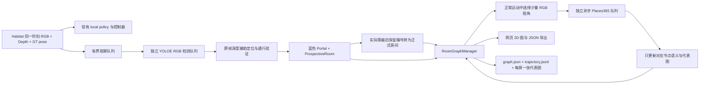

# Room-Level Semantic Topological Memory（第一版）

这是执行任务时被动积累的房间记忆。输入同步 RGB-D 与位姿，输出已访问空间、候选通道、已穿越的房间连接、轨迹及房间语义。不会调用导航动作，不改变 LightNav / OmniVLA 输出或速度，不做覆盖探索，也不长期保存深度图、点云或物体坐标。

2026-10-07 增加可关闭的二维房间范围：默认与 `--room-memory` 一起开启，用 GT pose 累积墙体/覆盖证据并按 Portal 分区。页面显示彩色部分范围，未看到的边界保持不完整。配置、算法和实车接口限制见 [ROOM_REGIONS.md](ROOM_REGIONS.md)，真实回放见 [验证记录](../docs/ROOM_REGIONS_VERIFICATION.md)。

## 研究设计与取舍

当前系统已经有独立 Habitat 网页闭环和 GT pose，因此优先复用 Habitat-Sim、NumPy、aiohttp 及现有模型客户端。选择一个小的独立 `room_memory` 包，避免引入完整 SLAM 框架。截图中的工作经官方资料核对：

- [Hydra](https://github.com/MIT-SPARK/Hydra) 将几何地点聚合成房间，再进行语义分类，有 Habitat 接口，但系统同时包含层次三维图、几何重建和优化；当前需要的不是整套系统。
- [vS-Graphs](https://github.com/snt-arg/visual_sgraphs) 在 ORB-SLAM3 上结合结构语义与图优化，房间结构提取依赖额外建图组件；不能直接作为一个只吃 pose/depth 的小插件。
- [Passage-Aware Structural Mapping](https://arxiv.org/abs/2604.24707) 的 [doorway_integration 分支](https://github.com/snt-arg/visual_sgraphs/tree/doorway_integration) 将墙面几何、门与穿越证据结合。这里借鉴“看到开口≠已换房”和“实际穿越才连接”的设计，不宣称复现该论文算法。
- 也阅读了 OmniVLA `semantic_topology/pose_source.py` 和数据模型：保留观测时间对齐的原则，避免引入其 ROS、雷达及目标物体建图依赖。

没有复制上述研究项目源码，也没有安装它们的 ROS/ORB-SLAM/建图依赖。新代码只实现本任务需要的在线观察记忆。

必须批判看待的边界：

1. 瓶颈可能是桌椅之间、同一房间内部或走廊拐角。`crossing_confirmed` 只表示几何穿越证据，**不表示建筑学房间分割已证明正确**。开放式客餐厅没有可靠几何边界时可能仍是同一节点。
2. 前向相机无法在所有转弯、斜门、玻璃、遮挡或过窄视野下识别门户。当前默认 YOLOE-26s 提议开口，允许单侧墙面辅助深度定位，但模型本身仍可能漏检，不保证完整召回，宁可保留 unknown/漏检，也不按语义标签变化分房间。
3. `semantic_confidence` 和 probabilities 是分类器输出，未做概率校准；不能直接当作研究中的可信概率或失败触发阈值。默认 Places365 是固定 365 类场景分类器，通过人工映射聚合到房间类别，不具备千问的开放词汇与多图语言推理能力。未映射类别和低置信度保留 unknown。
4. `entered/glanced/partial` 是观测证据量，不等于搜索完成度。`unseen` 用于尚未进入的候选空间，`well_observed` 仍预留，本版不会凭五张图声称覆盖了整个房间。
5. Habitat 深度是理想的米制轴向深度，不是 D455 的完整噪声模型。当前采用默认网页相机内参和视野，后续实车需提供真实内参、对齐方式、相机到机器人外参及深度单位转换。
6. GT pose 下的已知门户回访可复用端点；视觉模式不自动合并从两个不同门口看到的候选空间。旧纯深度模式保留近邻轨迹关联。隔墙近邻、别名相似房间、复杂环路仍需独立验证，图像 embedding 接口没有安装后端。
7. 当前是单个连贯仿真回合的二维图。重置另建 session；不自动跨运行加载、合并地图，不提供多楼层/电梯的可靠区分。

## 数据流



所有 EGL 仍在原 Habitat 单线程执行器运行。深度与 RGB 同次观测，GT pose 同时间戳；前端 APOS/OPOS 使用的模型旧观测帧不会被送进建图。模块不访问 scene semantic sensor、GT room ID 或 navmesh 地图；navmesh 仍仅供原来的环境运动使用。

## 坐标与可替换接口

- `models.py:PoseSource.pose_at(timestamp, observation)`：提供与帧同步的 `(x,y,yaw)`；`HabitatGTPoseSource` 是当前适配器。实车里程计/VIO/ROS 适配器只需实现同一接口；本次未实现实车定位。
- `RGBDFrame(timestamp, rgb, depth, pose, camera, elevation=None)`：RGB 是 JPEG bytes，depth 是 H×W 米制轴向深度；相机参数由 `CameraModel` 显式给出；可选 elevation 用于单层高度保护。
- Core 世界坐标：+X 初始向前，+Y 左侧，yaw 正向逆时针；Habitat 映射为 `x=-habitat.z, y=-habitat.x, yaw=habitat.yaw`。机器人局部坐标为前/左/上；光学坐标为右/下/前。`camera_to_robot` 明确执行转换。
- `RoomSemanticClassifier.classify(frames)`：异步多视图分类，不接触 room_id 分配和运动。默认实现为 `places365_recognizer.py:Places365Recognizer`；`RoomEmbeddingSimilarity` 仅预留相似度接口。
- `RoomGraphManager.observe(frame)`：可以离线重放，也可由 Habitat/MuJoCo/机器人适配器喂入。核心不 import Habitat 或模型代码。

## 门户与房间转换

默认 `doorway.enabled=true`。`doorway_detector.py` 在独立常驻进程运行官方 YOLOE-26s；`doorway_depth.py` 使用源帧深度验证宽度和门后连续可通行区域。优先利用检测框底部实测深度与附近单侧/双侧墙条估计门口平面，不要求旧检测器的双侧门框或 wide→narrow→wide 条件。无效深度不是自由空间，关闭门、开口过窄或缺少通行证据时不建点。

第一帧通过 RGB 与深度验证即创建蓝色 `PortalEdge(status=unexplored,traversal_count=0)` 和 `ProspectiveRoom(visited=false)`。世界位置、法向（模 π）、宽度和源房间用于去重；持续更新位置、宽度和置信度。机器人接近门口时冻结平面，避免更新平面本身造成假穿越。候选房间画在门后的示意锚点，不是真实房间中心。

门内 ROI 可交给 Places365，候选标签显示为 `office?` 等。机器人连续运动真正穿过门口，并满足两侧 0.20 m 的迟滞距离后，才将原 P/R 编号转为红色 Portal 和正式 RoomNode。红色仅代表已穿越，不代表完整搜索。清空门外 ROI 批次，正式节点重新采集运动中的多视角；语义 epoch 防止迟到的候选分类覆盖正式分类。已知门户返回复用原房间，跳跃/时间空洞不算穿越。

YOLOE 结果始终使用源 RGB-D 的 pose/timestamp，近期连续位姿用于补记异步推理期间发生的穿越。`geometry.py` 仍运行并提供辅助诊断及 `geometry_supported`，不再作为视觉提议的双侧门框门槛。仅显式设置 `doorway.enabled=false` 时恢复原纯深度模式。

Places365 只改语义，不创建、合并或移动节点。JSON v3 保留 v2 的 `rooms`（已进入）、`prospective_rooms`（未进入）和蓝/红 `portals`；新增区域字段与结构诊断。门户配置和使用说明见 [VISUAL_PORTALS.md](VISUAL_PORTALS.md)。

## 轨迹、代表图与持久化

轨迹按位移、旋转或最长采样间隔保存。内存/页面默认仅保留最近 5000 点，`index` 是稳定全局索引；各房间 `trajectory_indices` 随环形保留窗口更新。原始起点独立保留，完整采样轨迹追加到 session 的 `trajectory.jsonl`。轨迹文件随运行增长，可按回合归档；不缓存无限 RGB-D。

每房最多保存 5 张缩小后的 RGB 于内存，进入、平移与转向可触发代表视角，重复视角被拒绝。不要求转圈。达到 3 个视角触发一次分类，离开或停止时不足 3 张也会提交；每次访问至多一次。当前版已达到 5 张后不会继续替换视图库，这是后续可改进点。

Places365 对每张图独立推理，先按 `config/places365_room_mapping.json` 把相关类别概率求和，再对多视角取均值。未映射类别的概率全部计入 unknown，不重新归一化到已知房间类别。**unknown 获胜时 confidence 为 0**，因为许多未映射类别的概率总和不代表识别出了某个房间。选择对获胜房间类别支持最高的输入帧作为 `representative_frame_id`；若获胜为 unknown，则选择单个 Places365 类别最高分的一帧。这是分类分数启发式，不保证视野最宽或图像最清晰。

磁盘每房保存一张代表图 `frames/R0.jpg`；分类前先保存进入时的图作为临时代表，分类成功后替换。其他视角不永久保存，深度和点云不落盘。房间 ID 和连边仍只由几何模块决定，不随分类标签变化。

默认输出：`habitat_demo/runs/room-memory/<session_id>/`：

- `graph.json`：原子替换的节点/边/近期轨迹快照；`representative_frame_id` 对应本房的 `frames/<room_id>.jpg`。
- `trajectory.jsonl`：全部采样轨迹，包含房间 ID。
- `frames/R*.jpg`：每房一张代表图。
- `structure.npz`：开启范围构建时的紧凑二维覆盖/墙体证据，不包含原始 RGB-D 或普通物体占据层。

停止/重新输入任务继续同一个图；重置场景保存旧图并建立新 session，旧的分类结果不能写入新图。`search_count` 预留且保持 0，`visit_count` 另记实际进入次数。

## 启用

默认使用本地 Places365，**不用输入 API key，也不用手动启动 Places365 服务**。在 Habitat 终端运行：

```bash
conda activate omnivla-habitat
cd ~/projects/LightNav-0/habitat_demo
CUDA_VISIBLE_DEVICES=1 ./run.sh \
  --scene /home/xrq/datasets/habitat/scene_datasets/hm3d/example/00337-CFVBbU9Rsyb/CFVBbU9Rsyb.basis.glb \
  --scene-dataset-config /home/xrq/datasets/habitat/scene_datasets/hm3d/example/hm3d_example_basis.scene_dataset_config.json \
  --host 0.0.0.0 --port 8090 \
  --room-memory --room-memory-config room_memory/config/default.json
```

先停止原 8090 Habitat 进程再启动；导航模型服务继续用原命令。默认读取 `/home/xrq/projects/places365/resnet18_places365.pth.tar` 和同目录的类别表，通过 `/home/xrq/.conda/envs/places365/bin/python` 启动常驻推理子进程。模型首次分类时加载一次，后续请求复用；CPU 默认 2 个线程，取消/超时或关闭时清理子进程。失败会显示在节点语义状态中，几何仍可继续记录。

本机环境检查：`omnivla-habitat` 为 Python 3.9.23 / NumPy 1.20.3，没有 torch/torchvision；`places365` 为 Python 3.10.22 / torch 2.2.0+cu121 / torchvision 0.17.0+cu121 / NumPy 1.26.4，没有 Habitat。现有两个环境不能直接作为同一个 Python 进程使用，因此默认保留它们，通过标准输入/输出传递少量 JPEG。这里只需一条 Habitat 启动命令，Python 子进程由程序管理；没有合并或升级现有环境。

适配器也提供 `mode: "in_process"`：在当前解释器的单独工作线程运行，需要该解释器已具备兼容的 torch 和 torchvision。它在 Places365 环境中可运行，但不代表现有 Habitat 环境已经支持同进程推理。

单独检查本地识别器（不启动 Habitat）：

```bash
cd ~/projects/LightNav-0/habitat_demo
/home/xrq/.conda/envs/places365/bin/python -m room_memory.places365_recognizer \
  /home/xrq/projects/places365/cam_example.jpg
```

输出 JSON 包含原始 Places365 Top-1 类别、365 类概率、Top-1 分数、代表帧 ID，以及 `places365_top5`。不按置信度过滤、不把未映射类别合并为 unknown。多视图时对原始概率取均值再取 Top-1；代表图选择对该类别支持最高的视角。

`cam_example.jpg` 是叠加 CAM 热力图的示例，不是原始相机照片。本机 ResNet18 对它预测 candy_store 16.2%、food_court 8.7%、ice_cream_parlor 6.4%；现在直接输出 `room_type=candy_store`、`confidence≈0.162`。旧代码曾因类别映射而返回 unknown/0，并非模型输出全零。CLI 保留的 `unmapped_probability≈0.965` 只是旧映射诊断，不再影响结果。实际评估请使用 Habitat/相机的原始 RGB。完整配置和可选千问后端见 [../CONFIGURATION.md](../CONFIGURATION.md)。

`live_semantics.py` 是独立的当前画面识别观察器：复用 Places365 子进程，默认每秒最多一次、只保留一张待处理新帧，不改 Room ID 或导航控制。网页相机下方显示单帧 Top-1、真实分数、结果对应图像时间、耗时、完成次数和错误；房间节点继续显示多视图结果。等待图像或推理失败不伪造分类。重置后丢弃旧回合的在途结果。关闭实时识别可设 `semantic.live_enabled=false`；`semantic.live_interval` 控制最小启动间隔。

省略 `--room-memory` 即恢复原页面和 RGB-only 采集，不额外执行深度/记忆算法。几何、轨迹和识别参数都在 `config/default.json`；修改配置后重启 Habitat 服务并刷新页面。旧 `semantic_min_confidence` 配置已不再过滤标签，旧 session 文件不会自动改写。

网页增设房间记忆面板：轨迹、起点、当前箭头、可点击房间节点、门户连接、蓝色未进入门口、红色已穿越门口、代表图和 JSON 导出。正式节点画在首次进入位置，候选节点画在门后示意位置，均不是真实房间几何中心。`GET /api/room-memory`、`/export` 和 `/frames/F*.jpg` 与导航控制接口独立。

## 验证和研究使用

自动测试覆盖合成深度门、无效深度/障碍拒绝、世界坐标投影、门口停留不换房、跨越及回访、不依赖语义换房、容量上限、慢分类、重置后旧结果隔离、JSON 格式/API 异常和浏览器显示。Places365 新增多视角概率聚合、未知类别保留、真实权重推理、常驻进程复用、取消清理及缺失权重时保留几何的验证。

`tools/smoke_room_memory.py` 是纯验证脚本：用 Habitat navmesh 找一条 GT 路线回放 RGB-D；它不代表基础模型导航效果、不是真实房间标注评测。核心只接收回放 RGB-D/pose。运行示例与真实观测记录见 `docs/ROOM_MEMORY_VERIFICATION.md`。

后续实验必须人工标注门户穿越时间和真实房间关联，测量误触发、漏触发、回访身份一致率、部分观测语义准确率、内存及延迟；可选云端后端还需评估 API 成本。没有人工真值的“画出了图”不能证明房间分割正确。本版本不实现 confusion/failure trigger、cloud correction 或策略切换调度，local policy 本来已可替换。

## 本次侧门漏检的已知边界

`R0` 是起始空间的持久节点编号，右侧是选中节点详情，不是 Places365 分类名，也不表示已确认真实房间边界。新版看到可信开放门口就分配候选 R1，不再等待穿越；穿越决定是否将其变为正式已进入节点。

用户在 HM3D 的 `Find a toilet.` 回合（session `bfe951ecd52c499dbf94b5bd5ab0f020`）运行到原默认 200 步后停止；现已改为默认不限步数。该回合记录 134 个轨迹点但没有门户。按保存位姿重渲染同场景，134 次采样中 130 次没有符合要求的双侧门框，4 次开口没有通过自由空间验证；没有产生候选。画面显示走廊内右转通过侧门，同帧双侧门框/近似正面限制导致漏检。重渲染是离线诊断，不是原 200 帧深度录像，也不提供房间真值。

2026-10-06 的视觉门户版本已接入 YOLOE-26s，并修正了扫描地面与 navmesh 高度差造成的门宽低估。重新回放该 134 点轨迹，29 次有效观测合并成一个未进入的蓝色门口；但原路线实际穿过的侧门仍被 RGB 模型漏检，不能据此声称侧门问题全部解决。另用 Habitat 可通行路线穿过已检测的门口并返回，真实 RGB-D + YOLOE 回放获得同一个红色 P0、两个正式节点并复用 R0。详见 [验证记录](../docs/VISUAL_PORTALS_VERIFICATION.md)。

## CLIP 与 Places365 可选后端

新增 `clip_recognizer.py`：通过已有 `omnivla` 环境的常驻 CPU 子进程加载本地 OpenAI CLIP ViT-B/32；默认类别为 bedroom、living room、bathroom、kitchen、dining room、office room、gym、lounge、laundry room、corridor。文本模板先编码、归一化和平均，每张 RGB 计算候选类别内的分数；多视图仍平均每帧概率后取 Top-1，不按阈值过滤。两种模型不决定 Room ID 或门户跨越。

在原 Habitat 命令中增加 `--room-semantic-backend clip`，改为 `places365` 即切回原识别器。默认配置仍保留 Places365；CLI 切换只替换语义后端，详情见 [配置说明](../CONFIGURATION.md)。网页实时标题和 `semantic_metadata` 记录实际后端。修改后重启 Habitat 并刷新网页，保留 LightNav/OmniVLA 模型服务。

`compare_semantics.py` 用同一组 1–5 张房间 JPEG 串行调用两个后端，保存图像 SHA256、首轮/热模型请求耗时、类别分布和配置。两个后端候选类别数不同，分数不可直接比较为准确率。CLIP 的固定类别更贴合当前 Room Node 定义，但其实际准确率需要同图人工标注对比；特别要观察 living room/lounge 等相似类别的混淆。

参考：[OpenAI CLIP](https://github.com/openai/CLIP)、[Places365](https://github.com/CSAILVision/places365)。本次同图联调报告见 [JSON](../docs/clip-places365-comparison-20261007.json)，它只有一张图，不是准确率基准。
