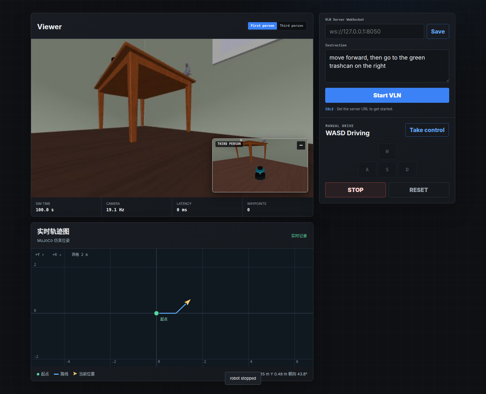

> 当前接入可通过 `--trajectory-map` 开启；默认关闭，`--no-trajectory-map` 显式关闭。关闭时不采样、不提供地图接口、不加载页面地图资源。切换需重启 MuJoCo 服务。

# 实时二维轨迹图

只根据连续位姿显示 **起点、实际路线、当前位置和朝向箭头**。不读取雷达，不创建特殊路口节点，不做语义识别、规划或底盘控制。

核心、适配函数、浏览器组件与测试均在本目录。MuJoCo 的后端和页面只保留少量接入代码。

## 在 MuJoCo 页面使用

在已经配置好的 LightNav 环境中：

```bash
cd /home/xrq/projects/LightNav-0/mujoco_demo
MUJOCO_GL=egl ./run.sh --vln-server ws://127.0.0.1:8050
```

打开 `http://127.0.0.1:8088`，相机下方出现轨迹图。`egl` 适用于这里的无窗口渲染环境；已有其他可用渲染后端时沿用原设置。

不启动模型服务器也能验证轨迹：点击 **Take control**，用 WASD 移动。自动导航仍需正常运行 LightNav 服务。

- 绿色圆点：本轮第一条有效位姿。
- 蓝线：已经行驶过的路线，不是模型预测轨迹。
- 黄色箭头：当前位置与航向，原地转动时也更新。
- 坐标单位为米，yaw 逆时针为正；起点平移到 `(0,0)`，不旋转原始坐标轴。
- STOP、结束导航、切换手动/自动、浏览器刷新均保留路线。
- RESET 清空路线并在仿真复位位置建立新起点。重启服务也会清空内存历史。
- 页面断网或位姿过期后保留最后轨迹，箭头变灰并显示未更新状态。
- 默认只保留有界内存历史；没有自动持久化文件。

首版来源明确标注为 **MuJoCo 仿真位姿**，不是 EKF 估计，不验证轮式里程计漂移或滤波精度。



## 独立安装和文件职责

```bash
pip install -e /home/xrq/projects/LightNav-0/trajectory_map
```

MuJoCo 的 `uv` 配置会自动安装该本地包。单独复制 demo 到其他机器时也要保留同级 `trajectory_map/`；或者安装此包后调整 demo 的本地依赖来源。组件资源随 wheel 安装。

| 文件 | 职责 |
|---|---|
| `src/lightnav_trajectory/model.py` | 位姿契约、起点归零、路线抽样、分段、容量、时序和 freshness |
| `src/lightnav_trajectory/adapters.py` | MuJoCo 快照与 ROS Odometry 转换，导入时不需要 MuJoCo/ROS |
| `src/lightnav_trajectory/web/trajectory_map.js` | 独立 Canvas 绘图、单请求轮询、断网显示和重置隔离 |
| `src/lightnav_trajectory/web/trajectory_map.css` | 地图样式与 MuJoCo 面板响应式布局 |
| `tests/test_model.py`、`test_adapters.py` | 核心与数据转换测试 |
| `tests/test_mujoco_integration.py` | HTTP 接入与 reset 测试，无图形/模型依赖 |
| `tests/test_browser.py` | Chromium 中运行组件，检查投影、箭头、过期和迟到请求 |
| `DESIGN.md`、`PLAN.md` | 设计依据与实施记录 |

## 通用位姿接口

核心仅依赖 Python 标准库，支持 Python 3.8+：

```python
from lightnav_trajectory import Pose2D, TrajectoryMap

trail = TrajectoryMap(min_step_m=0.05, jump_distance_m=2.0,
                      max_points=4096, stale_after_s=1.0)
trail.update(Pose2D(stamp_ns=1_000_000_000, x_m=6.5, y_m=13.8,
                    yaw_rad=0.0, frame_id="odom", source="ros_ekf"))
state = trail.snapshot()  # JSON-compatible，全量快照
trail.reset()            # 新会话；下一条有效位姿成为新起点
```

调用方在收到新的源数据时执行 update，不要仅为刷新网页而重复生成新时间戳。核心带锁，可由传感器线程写入、网页线程读取。

输入规则：

- 同一会话只有一个 source 和 frame_id；更换它们必须显式 reset。
- 时间戳为非负整数纳秒，重复或倒序返回 False，不覆盖最新位置；仿真从 0 开始合法。
- 位置、yaw 必须有限。非法数据引发 ValueError，保持原状态。
- 源时间用于排序，monotonic 接收时间用于判定断流。不要把 ROS 时间直接传到 `received_s`；这个可选参数主要用于可控时钟/测试。
- 原点只做平移，yaw=0 仍然指向来源的 +X。
- 位移达到 0.05m 才保存路线点，但每条有效位姿都更新实时箭头，快照会连接到当前末端。
- 单次位移大于 2m 会断开折线，避免将遥移画成实际行驶路线；阈值可配置。这个断点没有“路口”语义。
- 总点数上限 4096（含快照末端）；达到后对旧路线降采样保留分段端点。旧路线是显示近似，不用于精确轨迹计量。
- 如果断点过多且无法继续简化，历史停止增长并标记 `history_full`，箭头仍继续更新，不把不同段强行连接。

## 以后接小车 EKF

沿用 OmniVLA 已有的两步定位链路，无需重写滤波器：

```text
/odom → odom_covariance_adapter → /odom_ekf_input ─┐
/imu ──────────────────────────────────────────┤
                            robot_localization ekf_node
                                              ↓
                                    /odometry/filtered
```

`odom_covariance_adapter` 补齐未知协方差；`ekf_limo_v1.yaml` 开启二维融合并设置 `publish_tf=false`。本模块借鉴其“定位与导航解耦”的设计，直接消费最终 Odometry，不引入第二套 EKF 或 TF 发布者。

下面是未来 ROS 宿主中的订阅回调示例，不是本次已启动的车载节点：

```python
from lightnav_trajectory import TrajectoryMap
from lightnav_trajectory.adapters import pose_from_odometry

trail = TrajectoryMap()

def on_filtered_odometry(msg):
    try:
        trail.update(pose_from_odometry(msg))
    except ValueError as exc:
        node.get_logger().warning(str(exc))

# 在已有 ROS Node 中：
# node.create_subscription(Odometry, "/odometry/filtered", on_filtered_odometry, qos)
# HTTP handler 返回 trail.snapshot()，网页复用同一个组件。
```

适配函数保留消息的 header.stamp/frame_id，从四元数计算 yaw，并将 source 标为 `ros_ekf`。车上需要另行接 ROS 订阅与网页服务；本次没有把这些未实现连接称作完整实车部署。

## 以后接 Habitat

从环境获得机器人位姿后，先把坐标轴和航向转到右手平面坐标约定，再构造 Pose2D。时间用环境自身的仿真时间；新 episode 显式 reset。不要将 Habitat 的三维坐标分量直接冒充 ROS x/y/yaw。无需修改轨迹核心或浏览器组件；本次未实现 Habitat 坐标转换和运行桥接。

## HTTP / 前端复用

MuJoCo 托管只读 `GET /api/trajectory`，`Cache-Control: no-store`。核心字段：

```json
{
  "schema_version": 1,
  "session_id": "session-unique-id",
  "revision": 12,
  "source": "mujoco_ground_truth",
  "frame_id": "mujoco_world",
  "origin": [6.5, 13.8],
  "start": [0.0, 0.0],
  "segments": [[[0.0, 0.0], [0.5, 0.0]]],
  "current": {"x": 0.5, "y": 0.0, "yaw": 0.3, "stamp_ns": 1200000000},
  "point_count": 2,
  "status": "live",
  "age_s": 0.02,
  "stale_after_s": 1.0,
  "decimated": false,
  "history_full": false
}
```

未收到输入时 origin/start/current/source/frame_id 为 null，segments 为空，status=waiting；过期为 stale；MuJoCo 适配错误时 status=invalid 并提供 error。

前端可单独使用 `new LightNavTrajectory.TrajectoryView(canvas, {status, metrics, source})`，然后调用 `start(endpoint)` 以 5Hz 轮询；或者自行送 `setSnapshot(data)`。status/metrics/source 是可选 DOM 元素。宿主 reset 完成后调用 `invalidate()`，取消旧读取并清空画面；关闭组件调用 `destroy()`。

## 测试

核心测试不需要 ROS、MuJoCo 或 GPU：

```bash
cd /home/xrq/projects/LightNav-0
python -m pytest -c trajectory_map/pyproject.toml trajectory_map/tests/test_model.py trajectory_map/tests/test_adapters.py
```

MuJoCo 集成测试需要 demo 的开发依赖。浏览器测试还需要 Playwright 和 Chromium；没有 Playwright 时该文件明确跳过。可通过 `TRAJECTORY_BROWSER` 指定已有 Chromium 可执行文件。当前机器的 ROS 环境变量会引入无关 pytest 插件，隔离测试命令如下：

```bash
cd /home/xrq/projects/LightNav-0/mujoco_demo
uv sync --extra dev
uv pip install --python .venv/bin/python playwright
# 首次缺少浏览器时：.venv/bin/python -m playwright install chromium

env -u PYTHONPATH PYTEST_DISABLE_PLUGIN_AUTOLOAD=1 \
  .venv/bin/python -m pytest -p pytest_asyncio.plugin \
  -c ../trajectory_map/pyproject.toml ../trajectory_map/tests

env -u PYTHONPATH PYTEST_DISABLE_PLUGIN_AUTOLOAD=1 \
  .venv/bin/python -m pytest -p pytest_asyncio.plugin tests
```
